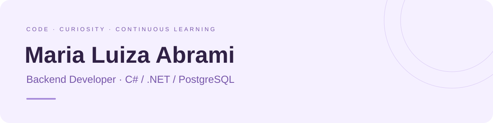

  

  <strong>Desenvolvedora Júnior na Exato</strong> 
  Foco em backend, curiosidade por toda a aplicação.

  

## Olá, eu sou a Malu

Sou **Desenvolvedora Júnior na Exato**, com foco em **C#, .NET e PostgreSQL**. Minha atuação também passa por outras áreas do desenvolvimento, ampliando minha visão da aplicação e a forma como suas partes se conectam.

Concluí **Análise e Desenvolvimento de Sistemas em dezembro de 2025** e sigo aprendendo na prática. Uso **inteligência artificial diariamente como apoio ao desenvolvimento**, para otimizar minha produção e explorar soluções.

Tenho experiência anterior com **sistemas financeiros, PIX e empréstimos consignados**, em atividades de desenvolvimento, sustentação e evolução de APIs.

## Meu foco hoje

  
  
  

| Desenvolvimento | Como faz parte da minha trajetória |
| :--- | :--- |
| **Backend** | C#, .NET, APIs REST e integração com bancos de dados |
| **Visão da aplicação** | Contato com frontend e outras áreas do desenvolvimento |
| **IA no dia a dia** | Apoio à produtividade e à exploração de soluções |
| **Base técnica** | Experiência com DDD, CQRS, Clean Architecture e princípios SOLID |

<strong>Outras tecnologias com que já tive contato</strong>

 

**Frontend:** HTML, CSS, JavaScript, TypeScript, Angular e React.  
**Backend e dados:** Java, Spring Boot, Oracle, MySQL e MongoDB.  
**Ferramentas e infraestrutura:** Git, Postman, Docker, RabbitMQ, Kafka, Jenkins e OpenShift.

---

  <strong>Vamos trocar ideias?</strong> 
  <a href="https://www.linkedin.com/in/maria-luiza-abrami-617bab330">Me encontre no LinkedIn</a>

